# Agent orchestration plan

**Status:** Accepted backend checkpoint implemented and frozen November 7, 2026. Sixty tests, real MCP, bounded orchestration, response/fallback, and encrypted local-peer demos pass. See [the handoff](OVERNIGHT-HANDOFF.md) for evidence and incomplete production requirements.\
**Date:** November 7, 2026.\
**Model requirement:** Every implementation worker uses **GPT-5.6 Sol** (`gpt-5.6-sol`). No silent fallback.\
**Capacity in this session:** Lead plus at most three concurrent workers.

**Current direction:** The user approved the full [Tether company plan](TETHER-COMPANY-PLAN.md), is building solo, and selected NVIDIA + NMC². Three explicitly GPT-5.6 Sol owners implement the revision: `tether_canvas` owns public UI/canvas modules; `tether_company_backend` owns canonical company data, imports, schedules, handoffs, HTTP and scoped MCP wiring; `tether_auth_security` owns auth, permission templates, exact response authority, the isolated retry fixture, model adapter, and adversarial review. The lead owns the [shared contract](TETHER-BUILD-CONTRACT.md), documentation, integration tests, browser verification, GitHub delivery, and concise user updates. One writer per module; narrow follow-up assignments preserve ownership. Earlier Photon and team work splits below are historical options.

There are two separate systems to plan: the development team building the app, and the incident-response agents operating inside the finished app. Their privileges and responsibilities are different.

## 1. Development team: lead stays in this chat

The lead owns product direction, task decomposition, shared interfaces, coordination, review, integration decisions, and concise communication with the user. Substantial implementation goes to bounded workers so the lead can handle new ideas and unblock dependencies.

The user has authorized delegation, overnight coding, autonomous routine decisions, and a dedicated cybersecurity agent. Research workers were planning-only. Three fresh implementation workers were launched explicitly as `gpt-5.6-sol` and now own domain/data, security, and communications/integration. Exact model overrides succeeded; the lead has not substituted a different implementation model.

The requested model is a hard assignment constraint, not a preference to reinterpret. Specify `gpt-5.6-sol` explicitly and use a fresh task context rather than inheriting the lead's model. If the launcher later rejects it, report the constraint; do not substitute models or create user-owned chats as a workaround. Public API configuration alone is not proof of desktop-launcher availability: [agent session configuration](https://developers.openai.com/api/reference/resources/beta/subresources/agents/subresources/sessions/methods/create). The successful direct launch is our session-specific evidence.

## 2. Planned worker ownership

| Worker | Model for implementation | Primary ownership | Required proof |
| --- | --- | --- | --- |
| Security owner | GPT-5.6 Sol | Threat model, scope/role policy, exact-action approvals, demo broker boundary, execution verification, abuse tests; reviews crypto/MCP/sync designs | Unauthorized, stale, replayed, changed-target, and cross-scope operations rejected; allowed action independently verified |
| Domain, data, and initial response owner | GPT-5.6 Sol | Shared schemas, graph evaluation, persistence, migrations, fixture data, event outbox, initial fallback transitions | Deterministic impact explanations, alternatives/unknowns/cycles, isolation, restart persistence |
| Communications owner, from the start | GPT-5.6 Sol | Three local peers, queue/envelope handling, actual relay/receipt/restart behavior; optional native phone spike | Actual encrypted logical-peer forwarding, replay/dedup/expiry checks, truthful receipts; physical three-device mesh explicitly unverified |
| Response and MCP owner, next assignment | GPT-5.6 Sol | Incident/task/fallback integration, service composition, MCP adapter, bounded product-agent runtime | Real MCP reads/proposal, verified fallback state, no approval or execution bypass |
| Integration/adversarial verifier, later wave | GPT-5.6 Sol | Cross-module failure cases, repeatable scenario/reset, evidence capture | Full scenario survives restart; broken/denied paths stay truthful |

These are responsibilities across waves, not five workers running simultaneously. The user confirmed both response and mesh are mandatory, so the first three implementation slots are security, domain/response, and communications. Keep the security owner dedicated throughout. Reuse the domain owner's slot for response/MCP once its core stabilizes; use a completed slot for integration verification. Research assignments do not grant broad coding authorization.

## 3. Dispatch sequence

### Next bounded documentation-derived wave

If implementation resumes, keep single-writer ownership and use explicit `gpt-5.6-sol` for every worker:

| Owner | Bounded assignment | Acceptance evidence |
| --- | --- | --- |
| Canvas workflow owner | Infinite canvas with typed nodes, labeled edges, node/edge input, failure-focused view, and contextual owners/tasks/backup plans | Real end-to-end fictional fixture; full graph preserved; no polished-design expansion |
| Photon/model integration owner | Configurable model adapter plus Photon round trip using extensive API interaction; scoped alert, human question, redacted read-only tool answer, check-in, evidence-linked handoff, and visible delivery state | Captured bidirectional human conversation; local correlation state and idempotent retry; no one-way-alert substitution or approval/execution tool |
| Security owner | Treat inbound content as untrusted; review allowlisted fictional sender binding, replay/rate bounds, message-to-evidence binding, redaction, scope, and authority separation | Adversarial tests show a phone number or message cannot approve, grant roles, widen scope, or issue execution commands |

The lead owns coordination of canvas/fixture work, sponsor-rule verification, integration review, and truthful submission language; bounded implementation workers own the code so the lead remains responsive. Preserve the frozen contracts until a reviewed change is necessary. A node connection, drag/drop interaction, role label, message, or model response must never create authority; reuse the server policy and exact-action approval flow. Run the Photon spike before UI/model work consumes the day. Timebox its go/no-go to a working round trip within 60 minutes and the first $5-$10 only if spending is separately authorized; otherwise select NMC² + NVIDIA. This documentation assignment does not create accounts, spend money, or claim the spike passed.

### Wave 0: planning and feasibility

- Lead: maintain the brief/contracts and incorporate the user's confirmed mandatory response-plus-mesh direction and 24-hour window.
- Dedicated security researcher: research the threat model, cryptographic/transport choices, control boundaries, and security acceptance criteria.
- Read-only audits: complete, including iOS 27.0.1 and no-third-device constraints. Exact model and build window are confirmed. The user accepted the concrete local-peer protocol demonstration in BUILD-PLAN.md on November 7, 2026; physical three-device mesh remains unverified.

**Research outcome:** Repository and transport/security research assignments are complete. Findings are in [FLOWSTATE-AUDIT.md](FLOWSTATE-AUDIT.md) and [MESH-FEASIBILITY.md](MESH-FEASIBILITY.md). The later overnight coding authorization supersedes the airport planning restriction. Current implementation evidence and ownership are in [OVERNIGHT-HANDOFF.md](OVERNIGHT-HANDOFF.md).

### Wave 1: contracts first, then independent slices

1. Give the domain owner the shared-contract and database skeleton task. Lead and security owner review the action/evidence/identity schemas before other workers depend on them.
2. Security owner builds policy and broker boundaries against the frozen contracts.
3. Domain owner builds deterministic evaluation, durable storage, and the first fallback state transitions.
4. Communications owner builds the accepted three actual local peers with distinct identities and persistent queues, real forwarding, signed recipient receipts, replay rejection, and relay restart behavior. Native phone installation is a timeboxed optional evidence path; no third device is expected. This remains a dedicated parallel implementation track.
5. When domain foundations stabilize, assign that slot to response/MCP integration. Keep communication protocol work running alongside the response loop.

Stub implementations used between workers must carry explicit `not_implemented` results. They may never emit successful execution, encryption, delivery, or verification receipts.

### Wave 2: integrate the response loop

Join graph → proposal → approval → broker → observer → fallback → task verification. Keep model calls optional so the deterministic core can be tested without network access.

The lead reviews the contracts and evidence; workers repair their own modules. The security owner exercises denial paths before the feature is accepted. A UI button or model-written explanation is not evidence that the action happened.

### Wave 3: joint proof of both mandatory pillars

The communications worker continues its original track while a freed slot handles integrated scenario evidence and failure testing. Keep the security owner available for transport/crypto review and final adversarial checks. Both response execution and real relay must have evidence before calling the demo complete.

The 24-hour plan is in [BUILD-PLAN.md](BUILD-PLAN.md). The user accepted the local-peer protocol proof on November 7, 2026. This supersedes the original physical demo criterion; retain the explicit limitation that physical three-device mesh remains unverified.

## 4. Assignment contract for every worker

Every task includes:

- Goal and connection to the approved demo.
- Exact model, role, and coding authorization status.
- Owned files/directories and prohibited shared edits.
- Input/output schemas and relevant contract version.
- Dependencies and allowed temporary stubs.
- Security invariants and data/credential restrictions.
- Acceptance criteria, including negative paths where relevant.
- Required handoff: changed files, verification commands/results, known limitations, blockers, and integration instructions.

Example bounded task:

> Implement approval validation for the static `stop_demo_scheduler` action. Own `packages/policy/approval.*` and its security tests. Consume contracts version 1; request contract changes through the lead. Reject target substitution, scope mismatch, expiry, revoked authority, and approval reuse. Do not call Docker, shell commands, model APIs, or network targets. Return decisions with reason codes and audit facts. Report tested behavior and any unresolved policy assumptions.

Do not assign vague tasks such as “make it secure” or “build the backend” without boundaries and proof.

## 5. File ownership and integration discipline

- One active writer per module. Workers coordinate shared contract changes before editing.
- The domain owner initially owns contracts, migrations, package manifest, and lockfile. Other workers request dependency or schema changes. Ownership can be explicitly handed off.
- The security owner reviews the security meaning of shared changes without concurrently editing another owner's files.
- Workers do not revert unfamiliar changes or run destructive resets. A shared workspace does not imply their changes are isolated.
- Separate worktrees are optional once a real Git repository and useful isolation exist. They are not a prerequisite for this empty workspace, and must not be created merely to add process overhead.
- Record interface decisions in the planning docs or an architecture decision record. Test doubles and real connectors must remain distinguishable.
- The lead accepts a handoff only when evidence matches the requested behavior, dependencies integrate, and limitations are recorded.

## 6. New-idea intake during implementation

1. Restate the intended benefit in one sentence and map it to the current response loop.
2. Classify it as a scope-preserving improvement, a material direction change, a security-sensitive integration, or a backlog item.
3. Identify affected contracts and the smallest demonstrable result.
4. Assign it to the appropriate GPT-5.6 Sol owner, or queue it if all three slots are occupied. Avoid interrupting unrelated work.
5. Have the security owner assess new trust boundaries, credentials, networking, and privileges before integration.
6. For scope-preserving work, use the user's existing authorization and continue. Discuss material product tradeoffs with the user; do not silently replace the approved priority.
7. Report what changed, what was verified, and what remains uncertain in a few sentences.

The lead remains the point of contact during active work, handles incoming user steering promptly, and avoids long blocking coding or waiting operations. A user-requested overnight thread heartbeat is configured through the 08:00 Dallas checkpoint; its identity and continuation rules are recorded in [OVERNIGHT-HANDOFF.md](OVERNIGHT-HANDOFF.md). Scheduling is not evidence that tests or implementation ran.

## 7. Product runtime: one trusted coordinator, bounded model roles

Start with one real agent runtime and one MCP client. It may use separate role prompts to prepare impact explanations, compare containment/fallback options, and draft incident updates. We do not need five autonomous model processes to demonstrate agentic behavior.

```mermaid
flowchart LR
    E[Committed incident event] --> O[Durable outbox]
    O --> R[Bounded run coordinator]
    R --> M[Scoped MCP reads and simulations]
    M --> P[Structured proposal]
    P --> V[Schema and policy checks]
    V --> H[Human review]
    H --> A[Exact-action approval]
    A --> X[Separate trusted executor]
    X --> C[Independent verification]
```

This coordinator is an application service. Its model-generated outputs cannot grant permissions. The development-worker model requirement does not by itself choose the deployed app's provider or runtime model; that remains explicit configuration rather than an accidental inheritance from the coding session.

If time remains, split product roles into an impact analyst, continuity/containment planner, and a read-only risk reviewer. Fan out only independent analysis against the same immutable snapshot. Keep one proposal writer; no model votes or “council consensus” can authorize infrastructure changes.

## 8. Runtime task lifecycle and budgets

Proposed run states: `queued → running → proposed | no_action | failed | timed_out | superseded`.

- Trigger only from a trusted, committed event such as `IncidentOpened` or a material `ObservationRecorded`; do not let arbitrary peer text dispatch privileged work.
- Run key: incident ID, triggering event ID, snapshot revision, role, and policy revision. Persist it before work and deduplicate repeated deliveries.
- Give every run an organization/incident-scoped principal, evidence snapshot, tool allowlist, output schema, token/cost budget, deadline, and correlation ID.
- Initial proposed ceiling: one active run per incident, 60 seconds per run, 12 tool calls, and at most one retry for a transient failure. Tune against actual provider limits after a measured smoke test; these are design budgets, not claimed performance.
- Cap global concurrent runs and input/output sizes. New evidence may supersede an old run; it does not justify an unbounded retry loop.
- Do not trigger the same analyst again merely because it saved a proposal. Prevent agent-to-agent event storms with event-type rules and correlation IDs.
- Before accepting a proposal, check that evidence IDs exist in scope and that its snapshot/preconditions are still current enough. Require reanalysis/review for material changes.
- If model access disappears, preserve the incident and use manual deterministic workflows. Offline data does not imply offline AI.
- Trace principal, tool, scope, input/output hashes where appropriate, evidence references, timing, and decisions. Redact payloads and secrets; a trace is not permission to retain sensitive data indefinitely.

## 9. MCP tool surface

The implemented stdio server exposes exactly eight tools: `get_incident`, `get_incident_timeline`, `get_dependencies`, `analyze_incident_impact`, `simulate_containment`, `list_fallback_plans`, `list_response_tasks`, and `submit_response_proposal`. The official client/server 2.4.0 SDKs negotiate modern MCP `2026-07-28` in the actual smoke test. Other tools in the broader table below remain planned. The scripted demo uses deterministic proposal input; the client bridge also allows the lead coding agent to reason over actual MCP responses without pretending a deployed autonomous model provider exists.

| Tool | Permission and behavior |
| --- | --- |
| `get_incident` / `get_incident_timeline` | Scoped read; redact unauthorized fields |
| `get_dependencies` / `get_critical_operations` | Scoped, bounded graph queries; no raw SQL |
| `analyze_incident_impact` | Deterministic calculation against a known revision |
| `simulate_containment` | Snapshot-only; cannot create an execution |
| `list_fallback_plans` / `list_response_tasks` | Scoped reads with evidence and prerequisite states |
| `submit_response_proposal` | Persist a schema-validated proposal; does not approve it or create a broker command |
| `draft_incident_announcement` | Return a draft linked to evidence; no implicit delivery |
| `get_execution_status` | Read-only, authorized execution/verification facts |

No initial tool grants approval, changes roles/policy, runs arbitrary commands, supplies arbitrary URLs to a connector, controls Docker, or bypasses the execution service. Add routine task mutation or message-sending tools only when explicit product policy and scope enforcement are implemented.

A proposal contains `proposal_id`, `organization_id`, `incident_id`, `snapshot_revision`, `evidence_ids`, `assumptions`, `action_type`, `target_id`, validated `parameters`, `expected_operational_effects`, `fallback_plan_id`, `verification_plan_id`, and `expires_at`. The server supplies actor identity and approval requirements; the model cannot self-declare either.

MCP is the tool interface. Scheduling, durable jobs, retries, cancellation, budgets, and approval enforcement belong to our application. Follow the compatible [official MCP specification](https://modelcontextprotocol.io/specification/2026-07-28) rather than assuming the protocol provides an autonomous scheduler.

## 10. Definition of done and remaining decisions

A worker is done when its code integrates with the shared services, behavior is demonstrated, relevant denial/failure cases pass, and remaining limitations are explicit. A security review is a requirement for accepting relevant changes, not a claim of complete security.

Implementation checkpoints:

1. Preserve the confirmed direction: both response loop and mesh mandatory.
2. Use the official November 7–8 12:00–12:00 Dallas build window, completed Flowstate audit, and accepted local-peer proof. Keep the earlier 10:00-10:00 estimate only as history. Record iOS 27.0.1/no third device and timebox optional native phone setup.
3. Use the verified explicit GPT-5.6 Sol override for each implementation worker, without substitution.
4. Freeze the first contract and fixture scope, then dispatch bounded assignments.

Direction confirmation is complete. Do not repeat answered scope, priority, hardware, or iOS questions. Dispatch requested implementation as bounded GPT-5.6 Sol tasks inside the accepted plan, without additional direction approval for routine choices. Record actual test results and incomplete requirements in the overnight handoff; roadmap diagrams do not imply every runtime component is implemented.
