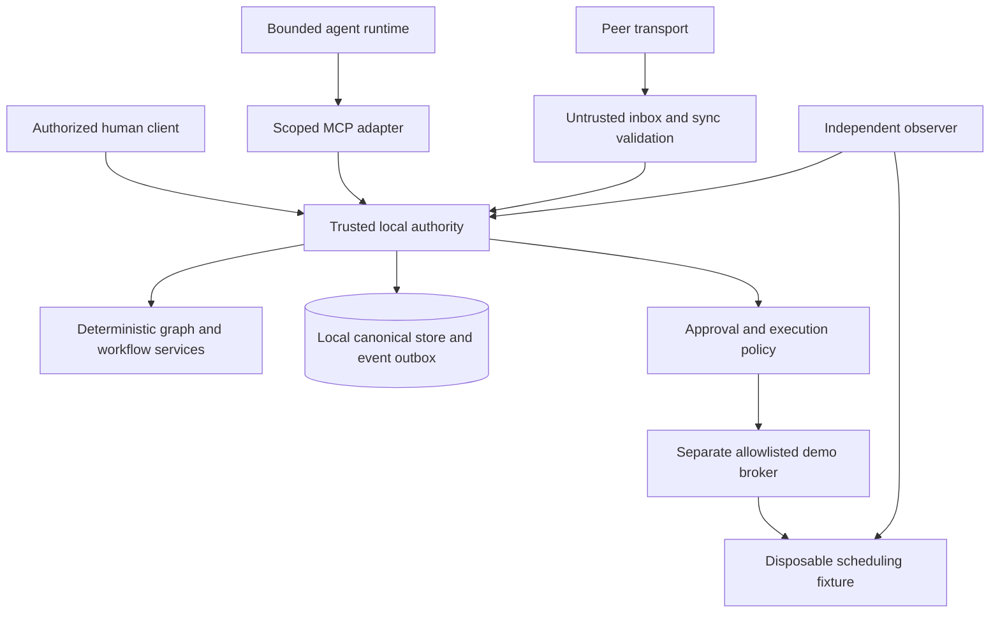

# Proposed backend architecture

**Status:** Response loop and three-local-peer mesh backend implemented and verified November 7, 2026.\
**Product:** Name TBD; Zero Day is the theme.\
**Date:** November 6, 2026.\
**Scope:** Backend, domain logic, cybersecurity, communications, and product-agent runtime. UI work is deferred.

## 1. Recommended product direction

Build an incident-response and operational-continuity engine for a fictional food pantry. The useful result is that distribution continues under a verified fallback after a scheduling integration becomes untrusted.

The graph explains operational consequences. Agents prepare evidence-backed proposals. A trusted service enforces authority. A narrow adapter changes real disposable infrastructure. Tasks and independent checks establish whether the fallback actually works.

The first scenario begins with a labeled, injected suspicious observation. We are not claiming to discover an exploit or automatically establish compromise. A separate health probe provides a real availability observation. An outage and a suspected compromise are different facts.

## 2. MVP scope and explicit cuts

| Capability | First working slice | Later / conditional |
| --- | --- | --- |
| Organization | One seeded pantry; scope checks tested with a second synthetic organization | Self-service onboarding and broad tenancy |
| Graph | Typed dependencies, AND/OR alternatives, unknowns, deterministic explanations, non-destructive incident filtering | Discovery, general constraint language, large graph optimization |
| Incidents | One scenario; sourced observations and freshness | SIEM/EDR integrations and broad automated detection |
| Response | One approved fallback with real persistent tasks and verification | Arbitrary workflow builder |
| Containment | Stop one allowlisted disposable scheduler; verify independently | Production connectors, generic network control, automatic policies |
| Local-first | Restart-safe incident context, procedures, local notes, pending updates | Peer-authoritative replicated state |
| Agents | One real MCP client with analysis and proposal tools | Parallel specialist council |
| Communications | Mandatory encrypted, authenticated relay track; persistent queues and honest receipts; early physical link spike | Universal transports, dynamic groups, and radio range-extension claims beyond measured proof |
| Presentation | Minimal development controls and readable output needed to prove behavior | UI design and polish |

The user confirmed that mesh and the response loop are both mandatory. On November 7, 2026 they accepted encrypted forwarding across three real local peers, optional separate Mac↔iPhone physical link, and an explicit statement that physical three-device/radio mesh is unverified. This supersedes the original physical demonstration criterion. Develop the communication protocol in parallel with the response engine; no further approval of this direction is needed.

## 3. Proposed technology choices

- **Domain and local authority:** TypeScript on a pinned, supported Node runtime. This keeps schemas, graph algorithms, application services, and MCP integration in one language.
- **Persistence:** SQLite on each participating device. Sensitive caches require a maintained encrypted distribution/binding, with OS-protected keys and verified runtime/native-driver/packaging compatibility. Ordinary SQLite permits a synthetic-data-only demo fallback with the encryption requirement explicitly unmet. The authority process is the only writer of canonical incident/approval/execution state. Other devices keep local caches, messages, and unaccepted updates.
- **Graph storage:** Relational node/edge tables plus in-memory adjacency indexes. A dedicated graph database is unnecessary for a seeded, small organization.
- **Validation:** Versioned request/event/proposal schemas with a maintained schema validator; exact dependency versions are selected and locked at implementation kickoff.
- **MCP:** An official maintained SDK, with a client/server protocol revision proven compatible in a smoke test. Prefer a local stdio integration for the first real client; do not expose a remote MCP endpoint by default.
- **Containment fixture:** A fixed demo container and a separate, tightly scoped execution broker. Prefer a dedicated disposable VM/rootless-capable environment; never mount the Docker socket into the app, MCP server, or an agent.
- **Device transport:** Proposed Apple-first Swift companion using Network.framework peer-to-peer support, subject to device/signing proof. On compatible devices, evaluate built-in CryptoKit HPKE and signing rather than adding native crypto bindings. The local authority remains separate; native transport cannot grant approval authority. Exact feasibility and sources are in [MESH-FEASIBILITY.md](MESH-FEASIBILITY.md).
- **Graphite:** Source at `/Users/vyomsingh/Projects/flowstate` has been audited read-only. Its graph lacks incident dependency semantics, IndexedDB is a cloud-backed cache, MCP exposes broad account mutations, and no mesh was found. Recommend a standalone core with selective inspected helper reuse, preserving all existing changes and production configuration. See [FLOWSTATE-AUDIT.md](FLOWSTATE-AUDIT.md).

SQLite WAL supports local reader/writer concurrency but still has a single writer and is not a shared-network-filesystem replication mechanism. Each device gets its own database; synchronization is application-level. See [SQLite WAL documentation](https://www.sqlite.org/wal.html).

These choices are implemented for the synthetic demo. The project uses the private official Node 26.13.0 toolchain selected by `scripts/dev.sh`, strict TypeScript ESM, Zod 4.6.7, ordinary `node:sqlite`, libsodium-wrappers 0.8.4, and the official split MCP client/server 2.4.0 packages. No hosted backend or production account is required.

## 4. Trust and process boundaries

The authority process is the MVP's coordinator for one organization/incident. It remains usable without a cloud backend. Local enforcement is still a trusted service boundary; renderer code, peer messages, and model output never decide permissions.

Other disconnected devices can read cached procedures, message, and queue notes. They do not become alternate approval authorities. There is no automatic coordinator election or failover in the MVP. If the authority cannot be reached, privileged actions wait.

An agent having OS access during development does not mean the product's runtime agent should have it. Product agents receive scoped application tools, never host management privileges.

## 5. Proposed module boundaries

These paths are the implemented backend layout. `packages/response` composes proposal-to-policy projection; UI modules remain future work.

| Module | Responsibility | Must not own |
| --- | --- | --- |
| `packages/contracts` | IDs, schemas, domain events, versioned service contracts | Transport or infrastructure side effects |
| `packages/graph-core` | Dependency evaluation, explanations, incident filtering | LLM calls, permissions, network access |
| `packages/workflows` | Incident, fallback, task, and recovery transitions | Raw Docker or shell control |
| `packages/response` | Exact proposal digest binding, policy preparation, revalidation, and verified evidence projection | Approval grants or broker implementation |
| `packages/agent-orchestration` | Durable bounded run state, trigger deduplication, tool budgets, and injected planner execution | Model credentials, approval, or infrastructure execution |
| `packages/policy` | Principal scopes, role checks, approvals, freshness rules | Trust decisions based on prompt text |
| `packages/storage` | Migrations, repositories, transactions, durable outbox | Public SQL tools |
| `packages/communications` | Envelopes, receipt verification, queueing, peer adapters | Approval or role mutation from peer traffic |
| `apps/authority` | Authentication, application service composition, serialized privileged writes | Arbitrary connector discovery |
| `apps/mcp-server` | Scoped, schema-validated tool adapter | Independent business logic or infrastructure credentials |
| `apps/agent-runtime` | Bounded runs, structured proposals, evidence references | Policy grants, approvals, direct execution |
| `apps/demo-broker` | Fixed target mapping and permitted action dispatch | Model-generated commands, paths, images, URLs |
| `fixtures/pantry` | Fictional graph, roster, scenario observations, disposable service | Real personal or production data |

## 6. Minimal shared data model

All records carry an organization scope and schema version. Incident records additionally carry incident scope where applicable. IDs received from callers do not establish authorization.

| Record | Essential meaning |
| --- | --- |
| `Principal` | Human, runtime agent, or enrolled device; separate role/capability assignments |
| `Node` / `DependencyGroup` | Resource or operation, requirement semantics, owner, criticality, revision |
| `Observation` | Source, evidence reference, subject, observed/received times, freshness, reported fact, verification status |
| `Incident` | Status, commander, affected subjects, evidence references, revision |
| `ImpactSnapshot` | Graph/evidence revisions, algorithm version, calculated states, paths, assumptions |
| `Proposal` | Author, evidence, selected action/fallback, assumptions, expected effects, snapshot revision |
| `Approval` | Exact action/target binding, human approver, policy revision, expiry, single-use state |
| `Execution` | Stable execution ID, target generation, attempt state, broker receipt, independent verification |
| `FallbackPlan` / `ResponseTask` | Prerequisites, owners, allowed transitions, acceptance evidence |
| `Message` / `Receipt` | Authenticated immutable payload and separately tracked relay/recipient receipts |
| `DomainEvent` / `OutboxEntry` | Durable committed history and pending subscriber delivery |

Avoid storing the same operational truth in unrelated graph, chat, and task stores. Graph views and timelines are projections of the shared services and events.

## 7. Dependency evaluation that is safe to explain

1. `A DEPENDS_ON B` means A requires B. Failure impact traverses reverse dependency edges from B to its dependents.
2. Ownership, communication, and assignment edges do not propagate service failure.
3. Requirement groups explicitly choose `ALL` or `ANY`. Optional requirements can degrade an operation without blocking it. Conditions use typed, bounded predicates, never an evaluated code string.
4. Internally use `satisfied`, `unsatisfied`, and `unknown`. For `ALL`, any unsatisfied requirement blocks; otherwise unknown propagates. For `ANY`, one satisfied alternative suffices; all unsatisfied blocks; the remainder is unknown.
5. Keep **availability**, **security trust**, and **freshness** separate. A responding but suspected-compromised scheduler is not automatically a safe source for a fallback roster.
6. A fallback becomes eligible only when its own prerequisites and evidence satisfy the relevant trust/freshness policy. Existence of an `ALTERNATIVE_TO` edge does not activate it.
7. Detect strongly connected components. Start unresolved cyclic dependencies at unknown, evaluate bounded monotone rules to a fixed point, and retain an explanation when no trusted external basis resolves the cycle. Do not let a cycle manufacture availability.
8. Emit evidence paths, assumptions, and graph/evidence revisions with every impact result. No invented risk percentages or model-generated dependency facts become canonical without validation.
9. Pruning is a deterministic query over the full graph. Incident relevance, critical operations, owners, approvals, active tasks, and fallbacks remain retrievable; no graph data is deleted.
10. Simulations operate on an isolated snapshot and cannot enqueue live execution events.

Graph tests cover direction, ALL/ANY/optional semantics, unknowns, cycles, fallback prerequisites, and deterministic explanations. These are core correctness properties, not tests that merely repeat implementation details.

## 8. Incident-to-recovery transaction

1. Record the injected suspicious observation with its actual provenance. Open the incident without asserting confirmed compromise.
2. Compute the impact snapshot from the persisted graph and observations.
3. The product agent reads scoped tools and proposes stopping `pantry-demo-scheduler` and using the preapproved backup roster. It cites existing evidence IDs.
4. A human reviews the exact action, target, operational effects, assumptions, and recovery procedure.
5. The authority creates a short-lived approval bound to the action, target identity/generation, parameters, organization, incident, requester, and relevant graph/policy revisions.
6. At dispatch, recheck the approver/requester authority, revocation, expiry, scope, target mapping, and preconditions. Atomically reserve the approval with a stable execution ID. A changed target or relevant stale state requires review again.
7. The broker accepts only the static action/target pair. Recheck the dispatch authorization and expiry immediately before the external effect, even if the approval was valid when reserved. The broker persists deduplication state before attempting the effect and returns a receipt. Expiry after an action has been dispatched does not cancel verification or reconciliation.
8. A separate observer checks the known fixture's process/health state. A broker response alone cannot mark containment verified. A failed health request alone cannot distinguish a stopped service from a broken observer; verification includes an observer-health/control check and, where available, separately scoped read-only runtime status.
9. After verified containment and approved fallback activation, create persistent assignments. Verify roster availability and the check-in procedure before marking distribution `running_on_fallback`.
10. Recovery of the scheduler requires separate verification and a separately authorized recovery action. A responding service is not proof of eradication. Close the incident only after defined recovery/reconciliation evidence is present.

Suggested execution states: `proposed → approved → reserved → dispatching → awaiting_verification → verified | failed | outcome_unknown`. Approval expiry before reservation or before the external dispatch blocks the effect and requires fresh authorization. A crash after dispatch requires reconciliation of the existing execution, not reuse of the approval to create a new action.

Do not promise exactly-once external effects. Use durable reservation, broker deduplication, idempotent desired-state operations, and reconciliation. If the observer or broker becomes unavailable, preserve uncertainty and require inspection before any conflicting action.

## 9. Local persistence and synchronization

- Commit domain mutations, audit records, and outbox entries in the same database transaction.
- Consumers use stable event IDs and durable processed-event records. Delivery can repeat; semantic effects must not.
- Use per-aggregate revisions for concurrent task/incident updates. Reject or queue conflicts instead of overwriting evidence.
- Merge verified ordinary messages by immutable ID. Treat conflicting task completions as claims until accepted by the authority.
- Never replay a queued privileged command just because connectivity returns. Revalidate policy, identity, target, expiry, and current incident state.
- Do not synchronize raw approval grants, authority changes, or broker commands as normal chat events.
- Local cache access has expiry/sensitivity rules; revoked access cannot retract data already cached on a disconnected device. Document that limitation and minimize cached content.
- Preserve local procedures, notes, queues, and delivery states across restarts. AI availability is optional; deterministic response logic continues without a model.

## 10. Mesh transport decision and proof

Actual inventory: one Mac, a possible iOS 27.0.1 iPhone, and no third physical peer. The accepted demonstration uses three independent local peer processes with distinct identities and stores. They must send real bytes over constrained adjacent links A–B and B–C, relay encrypted payloads A→B→C, and return recipient-authenticated acknowledgments. Treat this as logical-peer/protocol evidence on one host, with physical three-device mesh explicitly unverified. Phone-native integration is a separately timeboxed optional path; a signed-app smoke test has not yet succeeded.

Keep encrypted payloads separate from per-hop forwarding metadata. Immutable sender-authenticated content and recipient-authenticated receipts travel through a bounded, rate-limited relay queue. Forwarders cannot turn a relay receipt into a recipient acknowledgment.

Test duplicate arrivals, expired messages, reconnects, lost acknowledgments, queue exhaustion, forged receipts, and restart persistence. Disabling B must prevent new A→C delivery in the tested topology. Record whether the transport still depends on an access point or other infrastructure. Application forwarding on one LAN is useful but has a narrower claim than infrastructure-independent radio mesh.

Until end-to-end encryption and enrollment are verified, use only synthetic nonsensitive payloads and label the transport proof accordingly. Do not invent a cryptographic protocol to meet the demo deadline.

## 11. Build order and review gates

The user specified a 24-hour window: November 7 at 10:00 through November 8 at 10:00 Dallas time. The schedule is in [BUILD-PLAN.md](BUILD-PLAN.md). The local-peer proof is accepted; native phone deployment remains optional and unproven. Do not make a major OS/toolchain migration the default critical path.

| Gate | Deliverable | Evidence to move on |
| --- | --- | --- |
| 0: Direction and feasibility | Complete: both pillars and local-peer proof accepted; exact model verified; Flowstate audited; inventory confirmed | Carry these decisions into contracts and the constrained topology; timebox optional phone setup |
| 1: Contracts and security skeleton | Types, fixture, scope rules, migrations, observation/action schemas | Shared contract review and denied-access tests |
| 2: Operational core | Graph, incident state, persistent fallback tasks, outbox | Restart-safe end-to-end domain flow without AI |
| 3: Cybersecurity execution | Exact-action approval, fixed broker, independent observer | Allowed sandbox action plus target-swap/replay/unauthorized rejection |
| 4: Real agent integration | MCP reads and structured proposal | Real client transcript and stored proposal; agent cannot execute |
| Parallel mandatory track: Communications | Implemented local-peer protocol with honest delivery states | Actual A→B→C forwarding/acknowledgment, relay restart, tamper/replay checks; topology explicitly records one host; phone link is separate evidence |
| 6: Integrated demo | One resettable scenario and recorded limitations | Repeatable run without manual database edits or invented outcomes |

The user explicitly accepted the logical-peer demonstration. Do not reopen that approval or pursue a third device. Verify the accepted protocol behavior and retain the limitation that physical three-device mesh remains unverified.

## 12. Research anchors and unresolved decisions

The MCP specification currently resolves to revision `2026-07-28`. Use the actual compatible SDK/client revision, rather than assuming an old session model. See the [official specification](https://modelcontextprotocol.io/specification/2026-07-28) and [server guide](https://modelcontextprotocol.io/docs/develop/build-server).

Docker daemon access is a host-management trust boundary. The separate broker and disposable environment reduce exposure but do not make a compromised daemon harmless. See [Docker Engine security](https://docs.docker.com/engine/security/). The full researched threat model is in [SECURITY-PLAN.md](SECURITY-PLAN.md).

Implemented checkpoint: strict contracts, deterministic dependency evaluation, canonical incident/task/proposal/event/outbox persistence, exact-action policy, a private-IPC broker-owned disposable process, independent observation, a real modern MCP client/server session, persistent verified fallback tasks, and encrypted A→B→C logical-peer relay with signed recipient acknowledgments and restart recovery. `npm test`, `npm run typecheck`, `npm run mcp:smoke`, and `npm run demo` are the verification commands. Ordinary SQLite and mesh identity files remain plaintext synthetic-demo storage. The three peers are separate processes on one Mac, so physical three-device/radio mesh remains unverified. Native phone installation is optional and unproven. Naming remains TBD. Shared API details and provenance rules are in [DATA-CONTRACTS.md](DATA-CONTRACTS.md).
